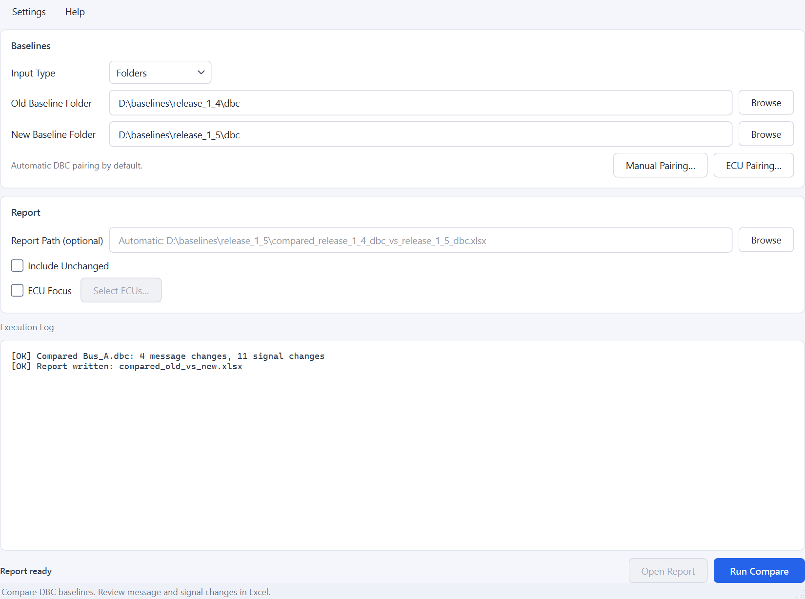
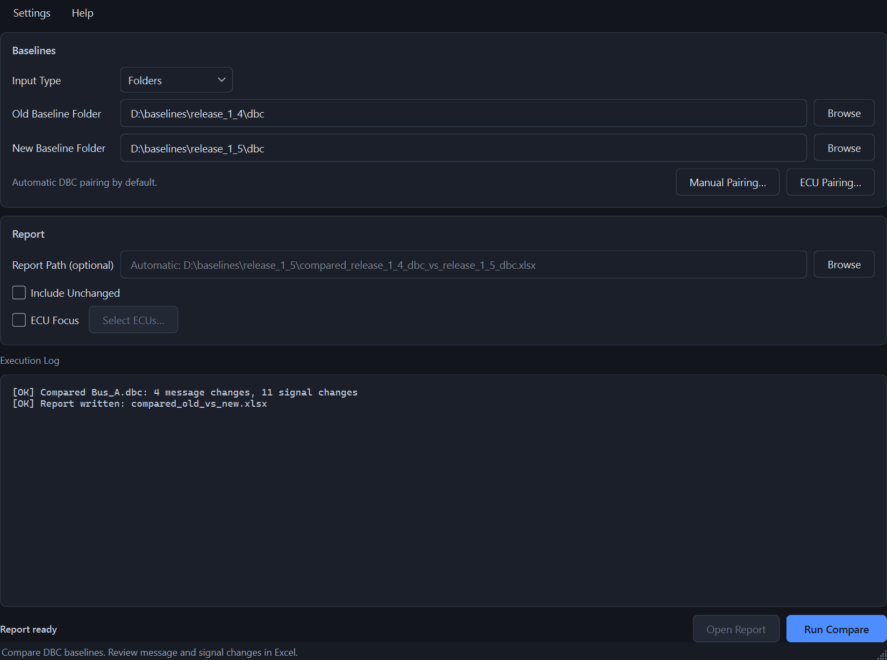

<div align="center">

# DBC Compare Tool

**Compare two DBC baselines and get an Excel report of every message and signal that changed.**

[](https://github.com/longvo92/dbc-compare-tool/actions/workflows/test.yml)
[](pyproject.toml)
[](LICENSE)

[Download](https://github.com/longvo92/dbc-compare-tool/releases/latest) · [Quick start](#quick-start) · [User Guide](resources/help/user_guide.md) · [Changelog](CHANGELOG.md)

</div>

A Windows desktop app for one job: diffing CAN databases. Point it at two `.dbc` files or
two baseline folders and it reports what was added, removed, modified or renamed — CAN ID,
DLC, cycle time, signal layout, scaling, value tables and ECU Tx/Rx routing — as an Excel
workbook you can hand to the next reviewer.



## Features

| Area | Use it to |
|---|---|
| Comparison | Compare two DBC files directly, or two baseline folders, into Summary, DBC Overview, Message Details and Signal Details sheets |
| Pairing | Pair files by path and rename score, force pairs with **Manual Pairing…**, mark OLD files as removed |
| ECU | Pair renamed ECU nodes so a rename is not read as a routing change; **ECU Focus** limits the report to selected nodes |
| Report | OLD/NEW columns, a **Changed Properties** delta per row, coverage and parse diagnostics, optional unchanged rows |
| Everywhere | Light and dark theme (or follow Windows), English or Tiếng Việt for the interface and the report independently, drag & drop, inputs remembered |

<div align="center">



</div>

## Quick start

1. Download the Windows `.exe` from [Releases](https://github.com/longvo92/dbc-compare-tool/releases/latest) and open it. No Python installation is needed.
2. Pick **Files** or **Folders**, then drop or browse the OLD and NEW baseline.
3. Optional: **Manual Pairing…** for the DBC pairs, **ECU Pairing…** for renamed nodes, **ECU Focus** to narrow the report.
4. **Run Compare**, then **Open Report**.

Sample baselines are in [examples/old](examples/old) and [examples/new](examples/new).

## Output

`compared_<old>_vs_<new>.xlsx` beside the NEW baseline, or a path you choose:

| Sheet | Holds |
|---|---|
| Summary | Complete/Incomplete, matching policy, change totals, coverage, file diagnostics, ECU mappings |
| DBC Overview | One row per file pair with its pairing confidence and reason (folder comparisons only) |
| Message Details | Every message change, with OLD/NEW identity columns and the property deltas |
| Signal Details | Every signal change, with its parent message on both sides |

## Requirements

- Windows for the packaged app.
- Python 3.11+ to run from source.

## Install from source

```powershell
git clone https://github.com/longvo92/dbc-compare-tool.git
cd dbc-compare-tool
py -m venv .venv
.\.venv\Scripts\python.exe -m pip install -e .
.\.venv\Scripts\python.exe -m dbc_compare_tool
```

## Limitations

- The app is GUI-only; there is no command line mode.
- Rename detection is heuristic; review Medium and Low confidence rows. Messages moved between files and signals moved between messages appear as Added/Removed.
- Split and merge matching, and editors for message or signal mappings, are not supported.
- Matching has synthetic regression coverage only; no production corpus with labeled mappings was available.

## Documentation

- [User Guide](resources/help/user_guide.md) · [Hướng dẫn tiếng Việt](resources/help/user_guide_vi.md)
- [Changelog](CHANGELOG.md)

The comparison engine is also vendored into [CAN Toolbox](https://github.com/longvo92/can-toolbox),
which adds a CAN log viewer around it. This repository is the source of truth for the comparison.

## License

[MIT](LICENSE) · Long Vo Thien
