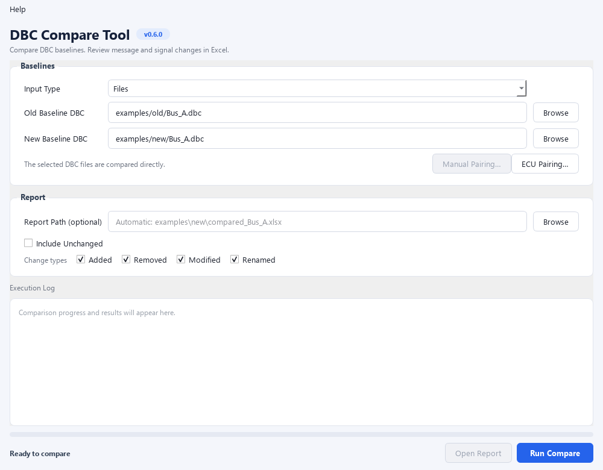
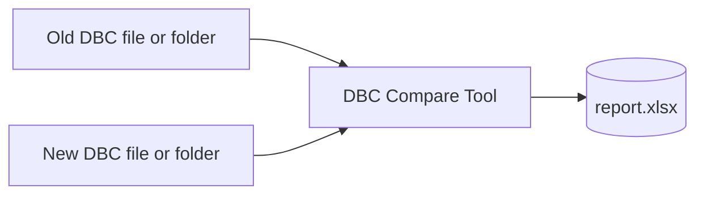
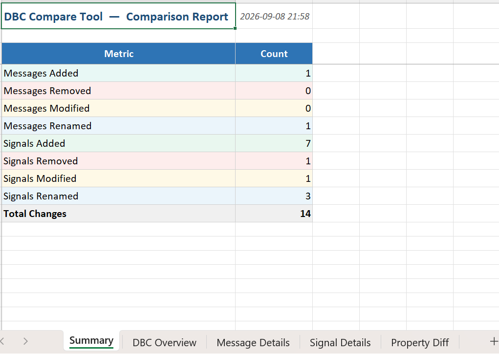
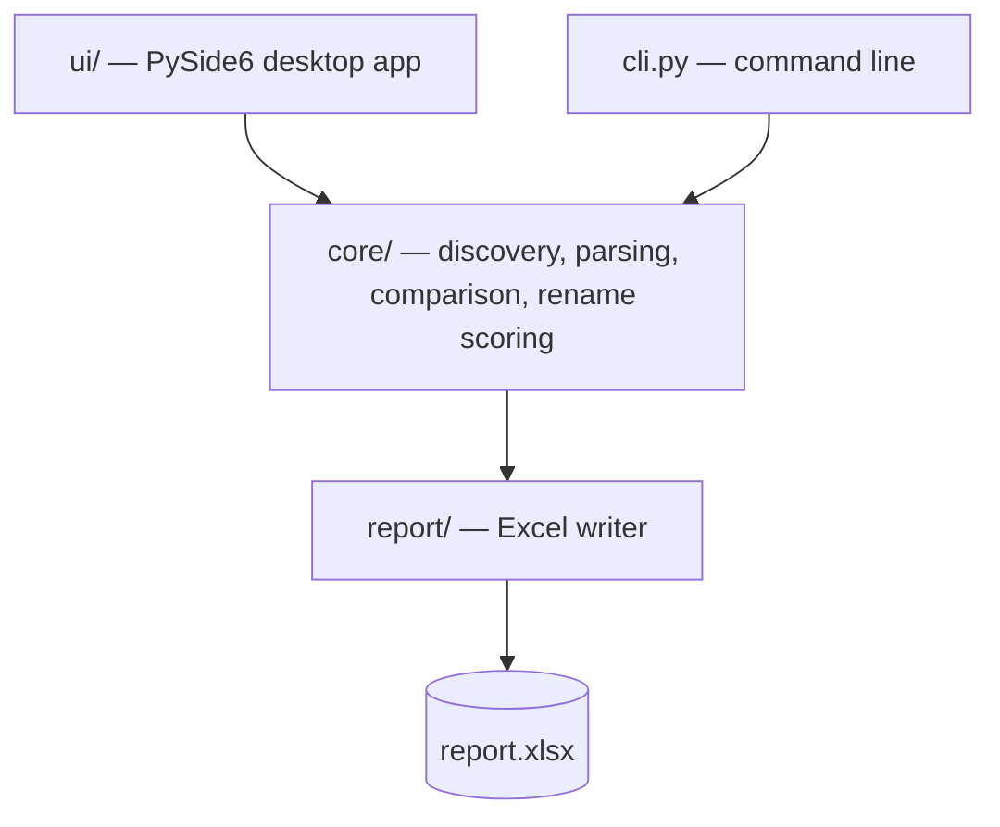

# DBC Compare Tool

> Compare two Automotive CAN DBC baselines and see what actually changed.

A Windows desktop + CLI tool that compares two DBC files or baseline folders and writes an engineering-grade Excel change report.



[](https://github.com/longvo92/dbc-compare-tool/actions/workflows/test.yml)
[](https://github.com/longvo92/dbc-compare-tool/releases/latest)
[](LICENSE)
[](https://www.python.org/)
[](#requirements)

---

## What it does

A text diff shows you which characters moved. This shows you which **messages and signals** changed.



Select two `.dbc` files to compare them directly, or two folders to discover and pair databases recursively. The tool compares messages and signals, detects likely renames, and writes one multi-sheet workbook.

### What it detects

|                        | DBC file | Message | Signal |
| ---------------------- | :------: | :-----: | :----: |
| Added / Removed        |    ✅     |    ✅    |   ✅    |
| Modified               |          |    ✅    |   ✅    |
| Renamed                |    ✅     |    ✅    |   ✅    |
| Value tables (`VAL_`)  |          |         |   ✅    |
| Comments (`CM_`)       |          |    ✅    |   ✅    |
| Parse error            |    ✅     |         |        |

---

## Features

- **Folder-level comparison** — recursively discovers all `.dbc` files in both baselines and reports every message and signal change between them.
- **Direct file comparison** — select **Files** in the GUI or pass two `.dbc` paths to the CLI. The selected files are compared as one pair regardless of their names.
- **ECU node pairing** — map an OLD node to its renamed NEW counterpart with **ECU Pairing…** or repeated CLI `--ecu-pair OLD=NEW` options. Paired names count as the same Tx/Rx node during comparison and rename detection; original names remain visible in the report.
- **DBC file pairing** — matches relative paths first, then chooses a global one-to-one pairing using shared filename/folder keywords and message content. Release/version decorations are ignored; shared keywords can pair DBCs even when their contents differ completely.
- **Manual pairing** — **Manual Pairing…** chooses DBC counterparts only. **Run Compare** exports directly; message and signal matching stays automatic.
- **Message rename detection** — scored over CAN ID, DLC, transmitter, cycle time, signal count and signal layout, so a message whose CAN ID changed can still be matched.
- **Signal rename detection** — first pairs signals whose complete properties match uniquely, including multiplexing, range, value tables and comments. This preserves bulk signal renames even when the parent message also changes name. Remaining signals use weighted similarity; Event Matrix-style messages use a more conservative, name-driven score.
- **Value tables and comments** — `VAL_` value tables are compared for signals, `CM_` comments for both messages and signals.
- **Change-type filter** — include only Added / Removed / Modified / Renamed in the report.
- **Include Unchanged** — optionally export all messages and signals, including `Unchanged`, with filterable OLD/NEW ECU Tx/Rx and technical properties.
- **Robust parsing** — an unparsable DBC is flagged `Parse Error` and the rest of the comparison continues; UTF-8, UTF-8 with BOM and the CANdb++ default encoding are all handled.
- **CLI mode** — same comparison engine, scriptable for CI or batch runs.

---

## Quick start

Ready-to-run Windows builds are attached to each [release](https://github.com/longvo92/dbc-compare-tool/releases) — download the one-file `.exe` and nothing needs to be installed.

Sample baselines for a first run live in [examples/old](examples/old) and [examples/new](examples/new):

```powershell
dbc-compare-tool --old examples\old --new examples\new --out comparison.xlsx
```

---

## The report

One workbook, five sheets:

| Sheet             | Contents                                                                                                                                                             |
| ----------------- | -------------------------------------------------------------------------------------------------------------------------------------------------------------------- |
| `Summary`         | Change counts by category, report title, generation time                                                                                                             |
| `DBC Overview`    | One row per file pair: status (`Matched` / `DBC Added` / `DBC Removed` / `DBC Renamed` / `Manually Paired` / `Parse Error`), pairing confidence/reasons, message/signal counts |
| `Message Details` | Every added, removed, modified or renamed message                                                                                                                    |
| `Signal Details`  | Every added, removed, modified or renamed signal, with rename confidence                                                                                             |
| `Changed Properties` | One row per changed property, before and after                                                                                                                    |

Rows are colour-coded by change type — 🟩 Added, 🟥 Removed, 🟨 Modified, 🟦 Renamed — and CAN IDs are written in hexadecimal (`0x1A3`).

`Message Details`, `Signal Details` and `Changed Properties` include separate **ECU Node Tx (Old/New)** and **ECU Node Rx (Old/New)** columns. Message Rx is the union of its signals' receivers; signal Tx comes from its parent message. Multi-node cells contain comma-separated names (use Excel's **Text Filters → Contains** for one ECU).

Detail sheets keep entity names, parent names, OLD/NEW CAN IDs, ECU context and rename confidence. Technical property snapshots and repeated before/after descriptions are removed; changes to DLC, cycle time, signal layout, scaling, range, multiplexing, value tables and comments appear only in **Changed Properties**. Selected ECU mappings are recorded in **Summary**.

**DBC File** contains only `old.dbc -> new.dbc` for paired files, or the available filename for an added/removed file. Paths and pairing evidence remain in their separate **DBC Overview** columns. Files with identical basenames in different folders can share a display label.

With **Include Unchanged**, unchanged entries appear in gray and are counted separately from **Total Changes**. `Unchanged` describes the entity's own compared properties after applying any selected ECU mapping: a message can contain modified signals, and a signal can belong to a renamed/modified message. Review both detail sheets and **Changed Properties**, which continues to list changed properties only. The Summary records the report mode and skipped parse-error count; check `DBC Overview` for incomplete coverage.

**`Summary` — the headline numbers:**



---

## Rename detection

Rename detection is a heuristic, not a proof. Structural properties carry the score and the name is supporting evidence, so a signal keeps its identity through a pure rename:

| Property  | Old            | New         |
| --------- | -------------- | ----------- |
| Name      | `VehicleSpeed` | `VehSpeed`  |
| Start bit | 16             | 16          |
| Length    | 16             | 16          |
| Factor    | 0.01           | 0.01        |
| Unit      | km/h           | km/h        |

→ reported as **Renamed**, High confidence.

Two limits are worth knowing before you trust a verdict:

- A unique match across all signal properties receives `High` confidence, including in Event Matrix-style messages. Duplicate full signatures and signals with changed properties fall back to similarity scoring; event-like fallback matches cannot reach `High`.
- Review a detected rename whenever the difference between `Renamed` and `Removed + Added` matters to you.

Scoring weights and known edge cases are in [docs/architecture.md](docs/architecture.md).

---

## Requirements

- Windows (the UI and path handling target Windows; the core engine is platform-agnostic)
- Python 3.9 or newer, to run from source
- Runtime dependencies: `cantools`, `openpyxl`, `PySide6` — `pyinstaller` is needed only to build the executable

---

## Install from source

```powershell
git clone https://github.com/longvo92/dbc-compare-tool.git
cd dbc-compare-tool
py -m venv .venv
.\.venv\Scripts\python.exe -m pip install -r requirements.txt
.\.venv\Scripts\python.exe -m pip install -e .
```

The `-e .` step is required: the package lives under `src/`, so `python -m dbc_compare_tool` only resolves after an editable install. It also puts two commands on the environment's `PATH` — `dbc-compare-tool` (CLI) and `dbc-compare-tool-gui` (desktop app).

---

## Usage

**GUI:**

In **Baselines**, choose **Folders** or **Files** under **Input Type**, then select OLD and NEW inputs of that type. **Manual Pairing…** selects DBC counterparts in folder mode; **ECU Pairing…** selects renamed nodes in either mode. **Report** holds the output path and export options. Inputs are locked during a run, and the footer shows comparison/export status.

```powershell
.\.venv\Scripts\python.exe -m dbc_compare_tool
```

**CLI:**

```powershell
.\.venv\Scripts\python.exe -m dbc_compare_tool.cli --old "path\to\old baseline" --new "path\to\new baseline"
```

`--old` and `--new` are required and must both be folders or both be `.dbc` files. Paths may contain spaces. `--out` is optional; when omitted, the report is written beside the NEW input as `compared_<folder-name>.xlsx` or `compared_<file-stem>.xlsx`. An explicit `--out` path must end in `.xlsx`. The GUI applies the same automatic output rule when **Report Path** is left empty.

Compare two files and account for renamed ECU nodes:

```powershell
dbc-compare-tool --old old.dbc --new new.dbc --ecu-pair VCU=VCU_NEW --ecu-pair BMS=BMS_NEW
```

Each NEW node can have one OLD counterpart. Unmapped names retain their original identity; mappings that collide with another unmapped node are rejected. Mappings apply across the selected inputs and do not filter out other ECUs. A routing change consisting only of a selected node rename is suppressed; actual Tx/Rx changes still appear in **Changed Properties**. Changing either input or **Input Type** clears saved file and ECU pairs in the GUI.

For a complete inventory for technical impact review:

```powershell
dbc-compare-tool --old examples\old --new examples\new --include-unchanged --out impact_review.xlsx
```

In the GUI, tick **Include Unchanged** before **Run Compare**. This disables and bypasses the change-type filters, including for manual DBC pairing. The default remains changes only.

Exit codes: `0` success, `1` parse or write failure, `2` bad arguments, invalid ECU pairing, or missing input.

`run_gui.bat` and `run_cli.bat` at the repository root do the same, using `.venv` in the repo.

---

## Development

Run the test suite:

```powershell
.\.venv\Scripts\python.exe -m unittest discover -s tests
```

CI runs the same suite on Linux and Windows against Python 3.9, 3.10 and 3.12, plus CLI comparisons of the bundled example folders and files. The comparison engine and report writers have no UI dependency; those jobs install `cantools` and `openpyxl` only and skip GUI tests. A separate Windows job installs Qt and exercises the GUI input and pairing workflow.

Build distributables (zipapp and one-file `.exe`):

```powershell
.\.venv\Scripts\python.exe scripts\build.py        # both
.\.venv\Scripts\python.exe scripts\build.py exe    # exe only
```

### Structure



The desktop app and the CLI share the same engine, and that engine has no UI dependency. Outside the package: `scripts/build.py` produces the distributables, `scripts/release_check.py` gates a release, `examples/` holds the sample baselines, and `tests/` mirrors the layers above.

## Documentation

- [User Guide](resources/help/user_guide.md) — step-by-step usage, also in the app's Help menu
- [Changelog](CHANGELOG.md) — every released version, also in the app's Help menu
- [Architecture](docs/architecture.md) — layers, data flow, rename scoring weights, validation status

## Contributing

Issues and pull requests are welcome. For changes to comparison or rename-detection logic, add or update tests under `tests/`, and keep the comparison engine free of UI imports so it stays usable from the CLI and CI.

## Author

**Long Vo Thien**

## License

[MIT](LICENSE) © Long Vo Thien
